# The Future-Ready, Human-Centric Workplace Ecosystem

> **Better-supported employees. Safer journeys. Stronger mobility.**

A vendor-neutral platform that turns an employee's voice (a WhatsApp reply, a pulse answer, a report) into an owned, tracked action with a visible, verified outcome. WhatsApp is the employee channel; a web app and PostgreSQL are the system of record. Optional modules extend the same core to safety, commute, wellbeing, workplace data, AI trust, manager coaching and inclusion.

> **Status:** design stage. This README describes the product, architecture, trust rules and plan. No code has been written yet. Everything marked "suggested" is a recommendation to confirm with your team, counsel and pilot customers.
>
> **Companion document:** the *Core Workflow and Trust Specification* defines the state machines, anonymity limits, access rules, delivery guarantees, retention rules and acceptance tests in full. This README summarises it. Where they differ, the specification wins. Export the specification into this repository as `docs/core-workflow-and-trust-spec.md` and keep the two in sync.

---

## Table of contents

1. [Why this exists](#1-why-this-exists)
2. [The gaps we address](#2-the-gaps-we-address)
3. [What the platform does](#3-what-the-platform-does)
4. [Architecture](#4-architecture)
5. [User flows](#5-user-flows)
6. [Issue and incident workflows](#6-issue-and-incident-workflows)
7. [Reporting modes and anonymity](#7-reporting-modes-and-anonymity)
8. [Features by role and authorization](#8-features-by-role-and-authorization)
9. [Delivery guarantees and failure handling](#9-delivery-guarantees-and-failure-handling)
10. [Data model](#10-data-model)
11. [Tech stack](#11-tech-stack)
12. [Privacy, security and data lifecycle](#12-privacy-security-and-data-lifecycle)
13. [Intelligence and measurement](#13-intelligence-and-measurement)
14. [Roadmap and release plan](#14-roadmap-and-release-plan)
15. [Success metrics and acceptance tests](#15-success-metrics-and-acceptance-tests)
16. [Proposed repository structure](#16-proposed-repository-structure)
17. [Getting started (when code exists)](#17-getting-started-when-code-exists)
18. [Assumptions and open questions](#18-assumptions-and-open-questions)
19. [Evidence and sources](#19-evidence-and-sources)
20. [Contributing and license](#20-contributing-and-license)

---

## 1. Why this exists

Workplace technology has grown into separate tools: listening and survey platforms, hybrid-office booking tools, commute vendors, wellbeing and counselling apps, and benefits portals. Each holds data the others never see, and employees are asked to use yet another app.

Meanwhile the human picture is not improving:

- Gallup's 2026 State of the Global Workplace reports global engagement at 20% in 2025, the lowest since 2020, with an estimated cost of about $10 trillion in lost productivity. Manager engagement fell from 27% to 22%.
- In India, Gallup's 2025 report found nearly half of employees looking to leave, 30% reporting daily stress and engagement falling from 33% to 30%.
- A Workday survey of 5,400 employees found only 42% trust their employer to deploy AI for employees' benefit, not just the organisation's.
- In Karnataka, a September 2026 amendment removed mandatory women's night-shift transport safeguards (driver verification, fixed routes, control rooms and more), leaving employers to set their own standard.

Measurement tools are mature, yet engagement keeps falling. The missing piece is **closing the loop**: signal, then owner, then deadline, then a verified outcome the employee can confirm. That only works if employees trust the system, so trust is designed in before features are added.

## 2. The gaps we address

These come from our market research (see [section 19](#19-evidence-and-sources)). The gaps are our analysis and inference, not documented facts.

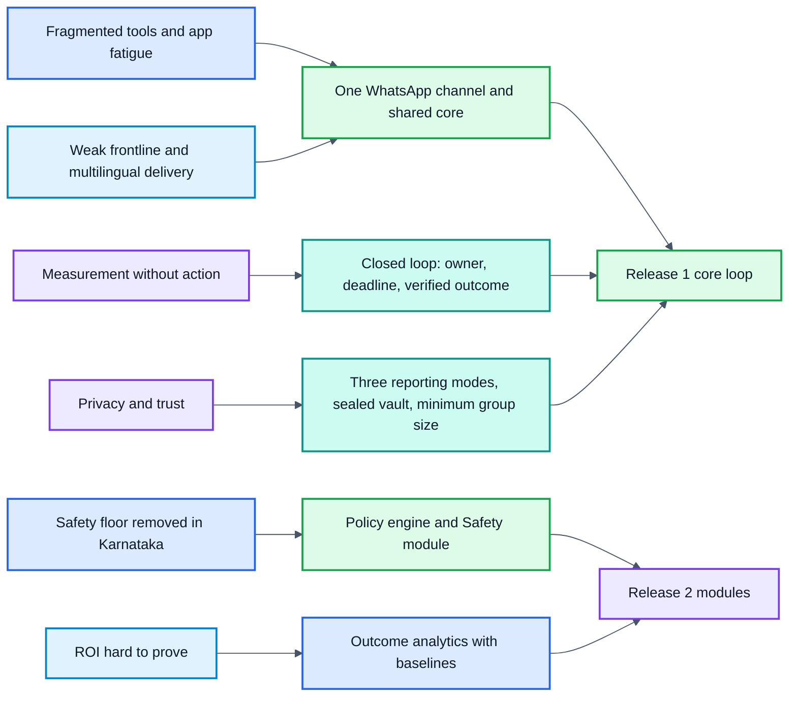

Gaps on the left are grouped from the table below; the right side is the part of the design that closes them and the release that ships it.

| # | Gap | How the design closes it |
|---|---|---|
| 1 | No one connects workplace, commute and wellbeing data | Connector layer plus outcome analytics over one data model |
| 2 | Frontline and shift workers in India are underserved | WhatsApp-first, multilingual, roster by site and shift |
| 3 | ROI is hard to prove | Outcome analytics with a defined measurement model |
| 4 | Karnataka safety floor removed | Policy engine for configurable duty-of-care rules; Safety module with a separate incident workflow |
| 5 | App fatigue | No new employee app; WhatsApp plus Teams or Slack |
| 6 | Privacy by design | Three reporting modes, sealed identity vault, minimum group size, consent enforcement |
| 7 | Measurement without outcomes | Owner, deadline, escalation and employee verification on every issue |
| 8 | The deskless majority | No desk, email or English required |
| 9 | No vendor-neutral layer | Public API, event feed, HRIS and vendor connectors |
| 10 | No trust layer for AI at work | AI-use pulse, disclosure rules; AI only assists humans |
| 11 | Manager enablement | Weekly top three actions in the core; nudges and playbooks in a module |
| 12 | Inclusion by design | Adjustment-request workflow with a named approver; inclusion analytics |

### Competitive landscape (summary)

| Segment | Examples | What is missing |
|---|---|---|
| Employee listening | Workday Peakon, Microsoft Viva Glint, Qualtrics, Culture Amp | Ecosystem lock-in; weak frontline and multilingual delivery; measurement without action |
| Workplace experience | Envoy, Robin, Eptura, Appspace, Microsoft Places | Built for hybrid desk offices, not shift or frontline workers |
| Commute / mobility (India) | MoveInSync, Routematic, Uber Shuttle | Focused on routing, fleets and cost; no link to wellbeing or feedback data |
| Wellbeing / EAP | Wysa, YourDOST, Amaha | Disconnected from workplace and manager data |

## 3. What the platform does

**Core loop (release 1)**

- Weekly WhatsApp pulse (3 to 5 questions, multilingual)
- Raising an issue in one of three modes: named, confidential or anonymous
- Issue routing to an owner with a deadline, backup and escalation
- "You said, we did" status updates, with employee verification before closure
- Manager weekly "top three actions"
- HR dashboard by site, shift and team, with a minimum group size
- Tamper-evident audit trail
- Employee roster by CSV upload

**Platform capabilities (shared by every module)**

- Module framework: per-customer switches over a shared data model
- Policy engine: configurable duty-of-care rules, thresholds and escalation (release 2; release 1 uses hard-coded safety rules plus tenant-configurable routing and timers)
- Connector layer: public API, event feed, HRIS and vendor feeds
- Outcome analytics: joins issues and pulses to attendance and attrition, aggregates only

**Optional modules**

| Module | What it adds | Gaps |
|---|---|---|
| Safety | Duty-of-care rules, SOS through a separate incident workflow, audit packs | 4 |
| Commute | Vendor feeds, trip events, commute emissions data | 1, 3 |
| Wellbeing | Counselling referral, stress signals (with consent) | 1 |
| Workplace | Desk, visitor and attendance feeds | 1, 3 |
| AI trust | AI-use pulse, disclosure rules | 10 |
| Manager coaching | Nudges, playbooks, team-health view | 11 |
| Inclusion | Adjustment requests, inclusion analytics | 12 |

The core loop needs none of the modules. Each is switched on per customer.

```mermaid
%%{init: {'theme':'base','themeVariables':{'fontSize':'15px','primaryColor':'#dbeafe','primaryTextColor':'#0f172a','primaryBorderColor':'#2563eb','secondaryColor':'#dcfce7','secondaryTextColor':'#0f172a','secondaryBorderColor':'#16a34a','tertiaryColor':'#f1f5f9','tertiaryTextColor':'#0f172a','tertiaryBorderColor':'#94a3b8','lineColor':'#475569','textColor':'#0f172a','background':'#ffffff','edgeLabelBackground':'#ffffff','noteBkgColor':'#e0f2fe','noteTextColor':'#0f172a','noteBorderColor':'#0284c7','actorBkg':'#dbeafe','actorBorder':'#2563eb','actorTextColor':'#0f172a','actorLineColor':'#64748b','signalColor':'#334155','signalTextColor':'#0f172a','labelBoxBkgColor':'#ede9fe','labelBoxBorderColor':'#7c3aed','labelTextColor':'#0f172a','loopTextColor':'#0f172a','activationBkgColor':'#ccfbf1','activationBorderColor':'#0d9488','sequenceNumberColor':'#ffffff','stateBkg':'#dbeafe','stateLabelColor':'#0f172a','altBackground':'#f1f5f9','compositeBackground':'#f8fafc','compositeTitleBackground':'#ede9fe','innerEndBackground':'#475569','specialStateColor':'#475569','transitionColor':'#475569','transitionLabelColor':'#0f172a','attributeBackgroundColorOdd':'#f0f9ff','attributeBackgroundColorEven':'#e0f2fe'}}}%%
flowchart LR
    P["Weekly pulse on WhatsApp"] --> S["Signal: issue or low score"]
    S --> R["Rules: mode, urgency, route"]
    R --> O["One owner and a deadline"]
    O --> E["Escalate if overdue"]
    O --> V["Employee verifies the fix"]
    E --> V
    V --> L["Learn: recurrence and time to resolve"]
    L --> P
    subgraph Modules["Optional modules, release 2 and later"]
        M1["Safety"]
        M2["Commute"]
        M3["Wellbeing"]
        M4["Workplace"]
        M5["AI trust"]
        M6["Coaching"]
        M7["Inclusion"]
    end
    O -.-> Modules
    classDef blue fill:#dbeafe,stroke:#2563eb,stroke-width:2px,color:#0f172a
    classDef green fill:#dcfce7,stroke:#16a34a,stroke-width:2px,color:#0f172a
    classDef purple fill:#ede9fe,stroke:#7c3aed,stroke-width:2px,color:#0f172a
    classDef teal fill:#ccfbf1,stroke:#0d9488,stroke-width:2px,color:#0f172a
    classDef sky fill:#e0f2fe,stroke:#0284c7,stroke-width:2px,color:#0f172a
    classDef rose fill:#fce7f3,stroke:#db2777,stroke-width:2px,color:#0f172a
    class P,V,M1,M2,M3,M4,M5,M6,M7 blue
    class S,L green
    class R purple
    class O teal
    class E sky
    style Modules fill:#f8fafc,stroke:#94a3b8,stroke-width:1px,color:#0f172a
```

### Full feature list

The "Release" column follows the plan in [section 14](#14-roadmap-and-release-plan): 1 is the core loop, 2 adds the policy engine, connectors, outcome analytics and the Safety module, and 3 adds the remaining modules.

#### Employee experience (WhatsApp)

| Feature | What it does | Release |
|---|---|---|
| Opt-in and consent onboarding | Invitation from the roster, language choice, per-purpose consent | 1 |
| Weekly pulse | 3 to 5 multilingual questions, scheduled around shifts | 1 |
| Raise an issue | Named, confidential or anonymous, with a warning before anonymous submission | 1 |
| Status updates | "You said, we did" messages, with confirm or "not fixed" replies | 1 |
| Conversation handling | Buttons with numbered fallback, resume after interruption, language change keyword, stop keyword | 1 |
| Consent control | View and withdraw consent at any time | 1 |
| SOS and safety check-in | Alert with employee-visible acknowledgement status | 2 |
| Trip status and post-trip pulse | Commute updates and a short pulse after trips | 3 |
| Counselling offer | Referral, with consent, when stress signals repeat | 3 |
| Desk and visitor information | Workplace answers in the same chat | 3 |
| AI-use pulse | Short questions on AI at work, with a clear statement of what AI is and is not used for | 3 |
| Adjustment request | Request seating, lighting or schedule changes, visible only to the named approver | 3 |

#### Reporting and workflow (core)

| Feature | What it does | Release |
|---|---|---|
| Triage | Duplicate detection, rule-based categorisation, urgency keywords | 1 |
| Routing rules | Category and site to a primary and backup owner, versioned | 1 |
| Absence and delegation | Backup owner takes over; delegation expires and is logged | 1 |
| Conflict-of-interest bypass | Reports are never routed to someone they concern | 1 |
| Restricted queue | Sensitive reports go to the designated handler or committee | 1 |
| Deadlines and escalation | Persisted timers, automatic escalation to the next level | 1 |
| Reopen and verification | Employee confirms the fix or reopens; unconfirmed closures are recorded separately | 1 |
| Late-reply handling | A grace period for reopening; later replies create a linked follow-up issue | 1 |
| Comments and notes | Owner notes shown to the employee without revealing identity | 1 |

#### Managers

| Feature | What it does | Release |
|---|---|---|
| Weekly top three actions | The three items that most need the manager's attention | 1 |
| Issue actions | Accept, reassign, comment, mark done | 1 |
| Coaching nudges and playbooks | Weekly suggestions and team-health view | 3 |

#### HR and administrators

| Feature | What it does | Release |
|---|---|---|
| Roster upload | CSV import with site, shift and team mapping | 1 |
| Configuration | Pulse questions, languages, categories, routing rules, escalation timers | 1 |
| Dashboard | Trends by site, shift and team, with minimum-group-size suppression | 1 |
| Audit report export | Timestamped issue records and audit events with owners. Incident exports arrive with the Safety module (release 2) | 1 |
| Retention and consent settings | Per-tenant retention periods and consent purposes | 1 |
| Module switches | Turn modules on or off per customer | 1 |
| Policy configuration | Duty-of-care rules, thresholds and escalation per region | 2 |
| Connector setup | HRIS, commute vendor, workplace tool, counselling provider | 2 |
| Outcome analytics | Issues and pulses joined to attendance and attrition, aggregates only | 2 |

#### Safety module

| Feature | What it does | Release |
|---|---|---|
| Incident workflow | Separate queue, states and permissions from routine issues | 2 |
| Acknowledgement windows | Named backup responder, then an on-call manager | 2 |
| Two-channel alerts | WhatsApp plus SMS or voice, with alternate-channel fallback and undelivered status | 2 |
| Honest status messages | Never claims help is on the way or emergency services were contacted unless confirmed | 2 |
| False-alarm handling | Closed with a reason and reviewed for patterns | 2 |
| Contact-failure and unresolved paths | Logged contact attempts on every channel, then escalation with recorded handoffs | 2 |
| Closure authority | Only the safety officer or an on-call manager can resolve an incident | 2 |
| Post-incident review and audit packs | Structured review and exportable records | 2 |

#### Trust, privacy and security

| Feature | What it does | Release |
|---|---|---|
| Three reporting modes | Named, confidential and anonymous, chosen per report | 1 |
| Sealed identity vault | Separate encryption key; readable only by the messaging service | 1 |
| Minimum group size | Hides small groups and blocks filtering that would isolate a person | 1 |
| Consent enforcement | Withdrawal stops sends, cancels queued messages and updates aggregates | 1 |
| Retention and deletion | Daily jobs with verification, legal-hold support, backup-aware deletion | 1 |
| Tenant isolation | Row-level security, default-deny, cross-tenant tests | 1 |
| Tamper-evident audit | Hash chain with external checkpoints and insert-only permissions | 1 |
| Access auditing | Records sensitive reads, exports and admin access | 1 |

#### Reliability and operations

| Feature | What it does | Release |
|---|---|---|
| Idempotent processing | Duplicate webhooks and retries never create duplicate effects | 1 |
| Transactional outbox | A state change and its event are never out of step | 1 |
| Retry and dead-letter handling | Backoff, dead-letter queue and operations alerts | 1 |
| Delivery tracking | Per-message status, with failures visible to the owner and HR | 1 |
| Delivery reconciliation | Provider receipts update status; duplicate deliveries are detected and recorded | 1 |
| Escalation monitoring | Alerts when an overdue item has not escalated | 1 |
| Message budgets and send windows | Per-tenant cost caps and shift-aware sending | 1 |
| Backup and restore tests | Restores re-apply the deletion ledger | 1 |

#### Integrations

| Feature | What it does | Release |
|---|---|---|
| CSV roster import | Starting point for every customer | 1 |
| WhatsApp Business Platform | Employee channel, through an approved provider | 1 |
| SMS, voice and email | Safety alerts and fallback delivery (release 2); release 1 routine messages use WhatsApp only, with optional email digests for managers | 2 |
| Teams or Slack notifications | Manager alerts in tools they already use | 2 |
| Public API and webhooks | Customer and partner integrations | 2 |
| HRIS connectors | Automatic roster and reporting-line sync | 2 |
| Commute, workplace and counselling feeds | Vendor data for the optional modules | 3 |
| Single sign-on (SAML or OIDC) | Enterprise login for managers, HR and admins | Phase 4 |

## 4. Architecture

Every channel passes through secure ingress. Dependencies point one way: modules depend on platform capabilities and core interfaces; platform capabilities depend on core interfaces; the core depends on neither. So each new module reuses identity, consent, audit and messaging without the core knowing the module exists. All persistence goes through repositories and transactions, and all asynchronous effects go through outbox events. Start as a single deployable backend split by domain (a modular monolith); extract services only when load or team size demands it. The diagrams below separate the runtime flow from the dependency direction.

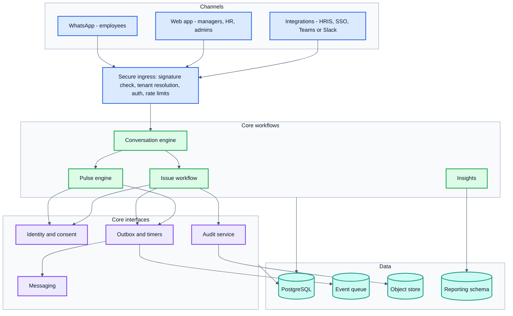

Runtime flow: channels reach ingress, ingress calls the conversation engine, and the engine calls workflows. Workflows use core interfaces and write state, audit and outbox rows in one transaction; a relay then drives messaging.

```mermaid
%%{init: {'theme':'base','themeVariables':{'fontSize':'15px','primaryColor':'#dbeafe','primaryTextColor':'#0f172a','primaryBorderColor':'#2563eb','secondaryColor':'#dcfce7','secondaryTextColor':'#0f172a','secondaryBorderColor':'#16a34a','tertiaryColor':'#f1f5f9','tertiaryTextColor':'#0f172a','tertiaryBorderColor':'#94a3b8','lineColor':'#475569','textColor':'#0f172a','background':'#ffffff','edgeLabelBackground':'#ffffff','noteBkgColor':'#e0f2fe','noteTextColor':'#0f172a','noteBorderColor':'#0284c7','actorBkg':'#dbeafe','actorBorder':'#2563eb','actorTextColor':'#0f172a','actorLineColor':'#64748b','signalColor':'#334155','signalTextColor':'#0f172a','labelBoxBkgColor':'#ede9fe','labelBoxBorderColor':'#7c3aed','labelTextColor':'#0f172a','loopTextColor':'#0f172a','activationBkgColor':'#ccfbf1','activationBorderColor':'#0d9488','sequenceNumberColor':'#ffffff','stateBkg':'#dbeafe','stateLabelColor':'#0f172a','altBackground':'#f1f5f9','compositeBackground':'#f8fafc','compositeTitleBackground':'#ede9fe','innerEndBackground':'#475569','specialStateColor':'#475569','transitionColor':'#475569','transitionLabelColor':'#0f172a','attributeBackgroundColorOdd':'#f0f9ff','attributeBackgroundColorEven':'#e0f2fe'}}}%%
flowchart LR
    MOD["Optional modules: Safety, Commute, Wellbeing, Workplace, AI trust, Coaching, Inclusion"]
    PLAT["Platform capabilities: module framework, policy engine, connector layer, outcome analytics"]
    CORE["Core workflows and interfaces"]
    MOD --> PLAT
    MOD --> CORE
    PLAT --> CORE
    classDef blue fill:#dbeafe,stroke:#2563eb,stroke-width:2px,color:#0f172a
    classDef green fill:#dcfce7,stroke:#16a34a,stroke-width:2px,color:#0f172a
    classDef purple fill:#ede9fe,stroke:#7c3aed,stroke-width:2px,color:#0f172a
    classDef teal fill:#ccfbf1,stroke:#0d9488,stroke-width:2px,color:#0f172a
    classDef sky fill:#e0f2fe,stroke:#0284c7,stroke-width:2px,color:#0f172a
    classDef rose fill:#fce7f3,stroke:#db2777,stroke-width:2px,color:#0f172a
    class MOD blue
    class PLAT green
    class CORE purple
```

Dependency direction: an arrow means "depends on". Modules and platform capabilities call core interfaces; the core never imports from them. Release 1 contains the core only. The incident workflow belongs to the Safety module and ships in release 2.

### The trust boundary

Between receiving a signal and acting on it, every report passes five stages. No model output alone may trigger a consequential action.

1. **Signal:** normalise (language, channel), drop duplicates, classify with deterministic rules.
2. **Policy and risk:** rules decide the reporting mode, urgency and route; sensitive or urgent cases take a restricted path.
3. **Action:** assign one owner and a deadline, enforce escalation, recover from failures.
4. **Verification:** close only on employee confirmation or a recorded, unconfirmed closure after a set window.
5. **Learning:** measure recurrence, time to resolve and aggregate reliability to see whether the action worked.

### Request path: a WhatsApp message through the stack

1. The employee replies on WhatsApp; the provider calls a webhook on secure ingress.
2. Ingress verifies the signature, identifies the tenant and puts the message on a queue.
3. A worker records an inbox receipt (so duplicates are ignored), loads the conversation state, then calls the pulse or issue workflow.
4. The workflow writes the state change, an audit record and an outbox event in one database transaction.
5. The policy engine checks the rules; a missed deadline creates an escalation job from a persisted timer.
6. The messaging service sends the reply or status update through WhatsApp using an idempotency key. Release 1 routine messages use WhatsApp only; SMS and voice fallback arrive with the Safety module (see section 9).
7. Aggregated results flow into the reporting schema for dashboards and outcome analytics.

## 5. User flows

### Employee

```mermaid
%%{init: {'theme':'base','themeVariables':{'fontSize':'15px','primaryColor':'#dbeafe','primaryTextColor':'#0f172a','primaryBorderColor':'#2563eb','secondaryColor':'#dcfce7','secondaryTextColor':'#0f172a','secondaryBorderColor':'#16a34a','tertiaryColor':'#f1f5f9','tertiaryTextColor':'#0f172a','tertiaryBorderColor':'#94a3b8','lineColor':'#475569','textColor':'#0f172a','background':'#ffffff','edgeLabelBackground':'#ffffff','noteBkgColor':'#e0f2fe','noteTextColor':'#0f172a','noteBorderColor':'#0284c7','actorBkg':'#dbeafe','actorBorder':'#2563eb','actorTextColor':'#0f172a','actorLineColor':'#64748b','signalColor':'#334155','signalTextColor':'#0f172a','labelBoxBkgColor':'#ede9fe','labelBoxBorderColor':'#7c3aed','labelTextColor':'#0f172a','loopTextColor':'#0f172a','activationBkgColor':'#ccfbf1','activationBorderColor':'#0d9488','sequenceNumberColor':'#ffffff','stateBkg':'#dbeafe','stateLabelColor':'#0f172a','altBackground':'#f1f5f9','compositeBackground':'#f8fafc','compositeTitleBackground':'#ede9fe','innerEndBackground':'#475569','specialStateColor':'#475569','transitionColor':'#475569','transitionLabelColor':'#0f172a','attributeBackgroundColorOdd':'#f0f9ff','attributeBackgroundColorEven':'#e0f2fe'}}}%%
flowchart LR
    A[Invited from roster upload] --> B[Opt-in and consent]
    B --> C[Weekly pulse, 3 to 5 questions]
    C --> D{Raise an issue?}
    D -- no --> E[Answers stored]
    D -- yes --> M[Choose mode: named, confidential or anonymous]
    M --> F[Routed to owner with deadline]
    F --> G[Employee sees status updates]
    G --> H{Fixed?}
    H -- yes --> I[Closed: you said, we did]
    H -- no --> J[Reopened and escalated]
    J --> F
    classDef blue fill:#dbeafe,stroke:#2563eb,stroke-width:2px,color:#0f172a
    classDef green fill:#dcfce7,stroke:#16a34a,stroke-width:2px,color:#0f172a
    classDef purple fill:#ede9fe,stroke:#7c3aed,stroke-width:2px,color:#0f172a
    classDef teal fill:#ccfbf1,stroke:#0d9488,stroke-width:2px,color:#0f172a
    classDef sky fill:#e0f2fe,stroke:#0284c7,stroke-width:2px,color:#0f172a
    classDef rose fill:#fce7f3,stroke:#db2777,stroke-width:2px,color:#0f172a
    class A,F blue
    class B,G green
    class C,I purple
    class E,J teal
    class M sky
    class D,H rose
```

### Manager (weekly)

1. Receives a WhatsApp or web notification with the team's top three items.
2. Opens an item, sees the report text and deadline without any reporter identity, and accepts, reassigns or comments.
3. Marks it done with a short note; the employee sees the note and is asked to confirm.
4. Items past deadline escalate to the next level automatically.

### HR and admin

1. Uploads the roster (CSV) and maps sites, shifts and teams.
2. Configures pulse questions, languages, routing rules, escalation timers and categories.
3. Reviews the dashboard by site, shift and team; groups under the minimum size are hidden.
4. Exports an audit report for issues, with timestamps and owners. Incident exports arrive with the Safety module in release 2.

### Module journeys

| Module | Employee | Manager, HR or officer | Trigger |
|---|---|---|---|
| Safety | Taps SOS or answers a check-in; is told a person has acknowledged it | Safety officer sees the alert and responds; the policy engine escalates to the backup if no one does | SOS or policy event |
| Commute | Gets trip status and a short pulse after trips | HR sees commute reliability and emissions next to issue trends | Vendor feed |
| Wellbeing | Is offered counselling, with consent, when stress signals repeat | HR sees aggregate stress trends only | Pulse trend |
| Workplace | Gets desk or visitor information in the same chat | HR sees attendance next to issue trends | Workplace feed |
| AI trust | Answers a short AI-use pulse; sees what AI will and will not be used for | HR sees the trust trend and open concerns | Scheduled pulse |
| Manager coaching | None | Manager gets a weekly nudge with a suggested next step | Weekly job |
| Inclusion | Requests an adjustment (seating, lighting, schedule) | Named approver reviews; HR sees counts above the minimum group size | Employee request |

## 6. Issue and incident workflows

### Issue workflow

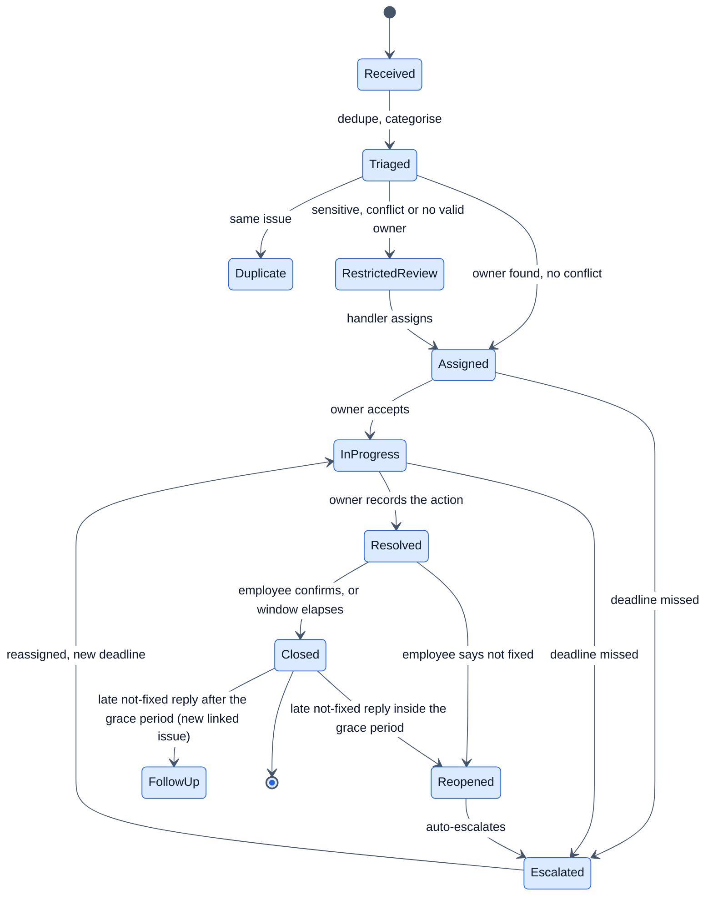

Guards and failure rules:

- Every issue carries a version; every transition is a compare-and-set on state and version. The losing writer gets a conflict and re-reads.
- Invalid transitions are rejected and logged.
- The state change, audit record and outbox event commit in one transaction.
- Duplicate inbound messages are ignored through the inbox receipt.
- Timers re-check the issue's state when they fire, so a late timer never acts on an issue that has moved on.
- "Closed" records whether closure was confirmed by the employee or unconfirmed after the window; the two are measured separately.
- **Late replies:** a grace period after closure (set per tenant from pilot data) lets a "not fixed" reply reopen the same issue. After it, the reply creates a linked follow-up issue. The original record and its audit history are never edited, the employee is told which happened, and reopens and follow-ups are counted separately.

### Incident (safety) workflow

Safety alerts run in their own queue with their own permissions and audit trail, separate from routine issues. The platform is not an emergency service, and onboarding says so.

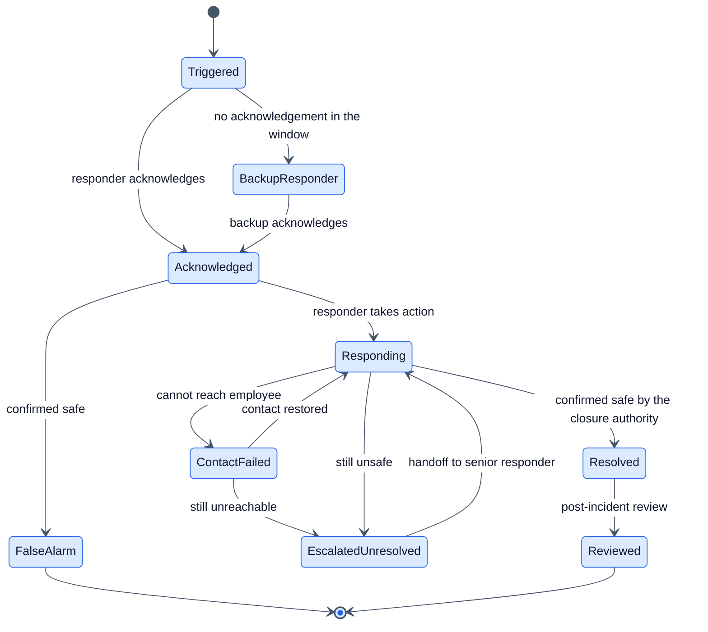

| Rule | Requirement |
|---|---|
| Acknowledgement | Each customer sets a window. An unacknowledged alert goes to the named backup, then to an on-call manager. |
| What the employee sees | Received, acknowledged by a person, responding, escalated. Never "help is on the way" or "emergency services contacted" unless a responder confirms it. |
| Delivery | Alerts go out on two channels (WhatsApp plus SMS or voice). A failed delivery triggers the alternate channel and shows as undelivered to the officer. |
| Contact failure | If responders cannot reach the employee, a set number of attempts on every available channel follow, each logged. If contact is not restored, the incident escalates to the unresolved state. |
| Unresolved | If the situation stays unsafe or cannot be resolved, the incident escalates to a senior responder with a recorded handoff and stays open until the closure authority closes it. |
| Handoffs | Each handoff names the previous and new responder, the time and the open actions. |
| Closure authority | Only the designated safety officer or an on-call manager can mark an incident resolved; the employee's confirmation is recorded but does not close it alone. |
| Connectivity loss | The employee sees the send status. With no acknowledgement, the message tells them to call the local emergency number. |
| False alarms | Closed with a reason, reviewed for patterns, never penalised. |
| Operating team | A documented rota with a named backup, and regular drills before and after launch. |
| Records | The full incident case is identifiable by design and visible only to the safety officer, responders on the case and the audit log. The employee sees an employee-facing status summary (received, acknowledged, responding, escalated, outcome) and never responder notes. Kept under the incident retention rule. |

### Operational readiness for the Safety module

The software can alert people; it cannot supply responders. The Safety module stays behind its own release gate until each pilot customer has:

- a **named operational owner** and a written responder rota with a backup for every shift;
- documented **acknowledgement windows, contact-attempt counts and maximum escalation delays**, with limits the platform will not let a tenant exceed;
- a **contact-failure procedure** (who calls, who visits, when to involve emergency services);
- a **drill passed** before go-live: unacknowledged alert, backup alert, unreachable employee, and handoff between shifts;
- coverage that matches what the product says. The app never implies continuous monitoring or guaranteed response unless that coverage is staffed; outside covered hours it states so plainly.

### Routing, ownership and conflicts

- **Organisation directory:** sites, shifts, teams, reporting lines and outsourced operators.
- **Routing rules:** category and site map to a primary owner and a named backup; rules are versioned.
- **Absence and delegation:** out-of-office issues go to the backup; delegation expires and is logged.
- **Conflict of interest:** a report that names or concerns the owner, or anyone in the owner's reporting line, skips to the next level or to the restricted queue.
- **Restricted queues:** harassment, misconduct and other sensitive categories go to the designated handler or committee, never to a line manager.
- **Unroutable reports:** go to restricted review, where a named person assigns them within a configured time.
- **Separation of duties:** auditors read only; HR cannot read confidential reports unless designated.

### Release 1 rules and the later policy engine

| Kind | What it covers | When |
|---|---|---|
| Hard-coded | State transitions, conflict-of-interest bypass, sensitive categories to the restricted queue, the minimum group size floor (5), mandatory audit records | Release 1 |
| Tenant-configurable and versioned | Routing table (category and site to owner and backup), deadlines and escalation timers per category, categories, languages, group-size threshold above the floor | Release 1 |
| Generalised policy engine | Rules over external events (trips, SOS, vendor feeds) and region-specific duty-of-care rule sets | Release 2 |

Every routing rule set and timer set carries a version, and each issue stores the versions that applied to it. A change affects new issues only, unless an admin re-routes an open issue. Every reassignment or re-route writes an `IssueEvent` with the previous owner, the previous rule version and a required reason, and the original version is never overwritten.

## 7. Reporting modes and anonymity

The platform promises anonymity from the employer, never from the platform operator or the WhatsApp provider, because both can see the phone number.

| Mode | Who can see the reporter's identity | How replies work | Use for | Limits |
|---|---|---|---|---|
| Named | The assigned owner and handlers | Direct | Routine issues | Employee accepts being known |
| Confidential | Only the designated handler or committee, not the line manager | Through the platform thread | Harassment, misconduct and other sensitive reports | Law or a formal inquiry may require disclosure |
| Anonymous | No one at the employer; the platform holds a sealed channel reference | Status updates relayed through the same WhatsApp thread | Routine feedback and low-risk issues | Small teams, timing and writing style can reveal who wrote it; cannot be investigated beyond the text |

The employee chooses the mode for each report and sees the choice before sending. Sensitive categories default to confidential. Before an anonymous submission, the employee sees a short warning about small-team and writing-style inference.

### Identity data paths by mode

| Mode | Where identity is held | Who can resolve it | If the key or the messaging service is compromised |
|---|---|---|---|
| Named | In the issue record, linked to the employee id | The owner, handlers and admins as the authorization matrix allows | Normal access controls and audit; no extra secrecy is promised |
| Confidential | Employee id in a restricted case table, separate from routine issue tables | The designated handler or committee only; every read is audited | Rotate keys and re-encrypt the table, review handler access, notify affected employees under the breach process |
| Anonymous | A sealed channel reference only; no employee id | The messaging service role through a decrypt call; no human path | Rotate the vault key and re-encrypt, alert on bulk decrypt calls, treat anonymous reporters as exposed to the compromised party and notify under the breach process |

Test the whole path for each mode: application logs, provider callbacks, support tooling, exports, backups and error traces. Logs never hold phone numbers or message text, and provider callbacks are matched to reports only inside the messaging service. Anonymity holds as a documented guarantee only while these tests pass.

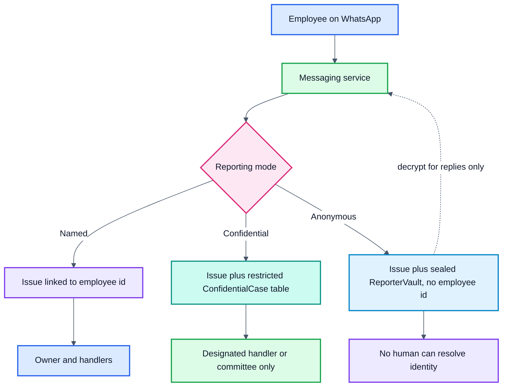

Each mode has a different path from the employee to the stored report. The anonymous path ends at the sealed vault, which only the messaging service role can read, and only to deliver status replies.

### Anonymity threat model (summary)

| Threat | Mitigation |
|---|---|
| Phone number exposure to staff | Sealed vault table with its own encryption key; only the messaging service role can decrypt; no admin screen; every access logged |
| WhatsApp provider visibility | Data processing agreement, minimal template content, disclosure to employees (cannot be removed) |
| Timing correlation | Show dates only, randomise display delay, avoid shift-level detail for small groups |
| Small-group inference | Precise site, shift and team live only in a restricted routing table; reporter-visible and analytics views use coarsened values and are suppressed below the minimum group size. Suppression is a mitigation, not a guarantee |
| Identifying content | Warn before sending; handlers cannot search free text by author |
| Insider joins | Separate schemas and roles; access audit events; alert on bulk reads |
| Reply leakage | Fixed sender, templated updates with no identifying detail |
| Export joins | Aggregate-only exports; row-level exports drop small-group fields |
| Legal compulsion | Documented process, counsel approval, disclosure recorded in the audit log |

Privacy testing must try to re-identify reporters through these paths before any real employee data is used.

### Contextual identifiers and small groups

An employee id is not the only way to find a reporter. Site, shift, team, timestamp and the report text can point to one person, especially in a small team. So the data is split by purpose:

| Layer | Fields | Who can read it |
|---|---|---|
| Report | category, mode, text, state | Owner and handlers, as the authorization matrix allows |
| Routing context (`IssueContext`) | precise site, shift, team, exact time | The routing service and the assigned owner only, and only as far as routing needs; not exported; not visible to HR dashboards |
| Analytics view | coarsened site or region, date only, category | Dashboards and exports, always with minimum-group-size suppression |

Rules:

- **Minimum group size applies to every analytics query**, including filter combinations and date ranges. A filter that would narrow a group below the minimum returns nothing, and repeated narrowing queries are rate-limited and audited.
- **Anonymous reports in a small team** are warned about before sending; if the team is below the minimum size, the owner sees the team's parent unit instead of the team.
- **Free text is not searchable by author**, and handlers see no writing-style metadata.
- **Suppression is not an anonymity guarantee.** The promise stays limited to what the threat model and the re-identification tests demonstrate.

**Suppression policy.** The platform floor is 5 and cannot be configured; each tenant has a threshold of at least 5 (default 8). The floor is a starting value for the pilot privacy review, not a proven safe number. To resist differencing:

- Dashboards use fixed calendar periods (week, month) and fixed groupings; arbitrary date ranges and ad hoc filter combinations are not offered.
- Before releasing a figure, the system checks the size of the group, the size of its complement and the size of the difference from every figure already released to the same role for an overlapping group and period. Any of these below the threshold suppresses the figure.
- When a suppressed cell could be recovered from a total, a second cell is suppressed as well (complementary suppression).
- Each role has a daily cap on distinct filter combinations; going over the cap is audited and blocks further queries.
- Row-level exports never carry group fields.

## 8. Features by role and authorization

| Role | Sees | Can do | Channel |
|---|---|---|---|
| Employee | Whether they answered each pulse (never the answers), status of own issues, own consent settings | Answer pulses, raise issues in any mode, confirm or reject a fix; with modules on: trigger SOS, answer the AI-use pulse, request a workplace adjustment | WhatsApp |
| Manager | Team's top three actions, issue text without identity; with modules on: coaching nudges, team-health view | Accept, reassign, comment, mark done, act on nudges, review adjustment requests assigned to them | Web app, WhatsApp alerts |
| HR | Dashboard by site, shift, team; outcome analytics; module reports | Configure pulses, categories, policies and timers; switch modules on or off; export aggregates | Web app |
| Admin | Roster, roles, connectors, consent settings | Upload roster, manage users, set up connectors, set retention, view audit log | Web app |
| Safety officer or committee | SOS and safety events, status of duty-of-care policies | Respond to SOS, review incidents, export audit packs | Web app, phone alerts |
| Auditor (optional) | Read-only incident records | Export timestamped records | Web app |

### Authorization matrix

Access is denied by default; each cell states the most any role may do.

| Resource | Employee | Manager | HR | Admin | Safety officer | Handler | Auditor | Operator support |
|---|---|---|---|---|---|---|---|---|
| Own reports | Read, confirm | No | No | No | No | No | No | No |
| Routine issues for own team (content only) | No | Read, act | Metadata only (category, state, age); text only when HR is the assigned owner or escalation handler | No | No | No | Read | No |
| Confidential reports | Own only | No | Only if designated | No | No | Read, act | Redacted read | No |
| Incident records | Status summary only | No | No | No | Read, act | No | Read | No |
| Reporter vault (identity link) | No | No | No | No | No | No | No | Messaging service only |
| Dashboards (aggregates) | No | Own team above minimum size | Read | Read | Incident counts | No | Read | No |
| Exports | No | No | Aggregates only | Aggregates only | Incident export (release 2) | Case export | Issue audit export (release 1) | No |
| Roster | Own record | Own reports | Read | Read, write | Incident context | No | No | No |
| Policies and routing rules | No | No | Read, write | Read, write | Read | Read | Read | No |
| Audit log | No | No | No | Read | Incident entries | No | Read | No |
| Connector credentials | No | No | No | Write only | No | No | No | No |

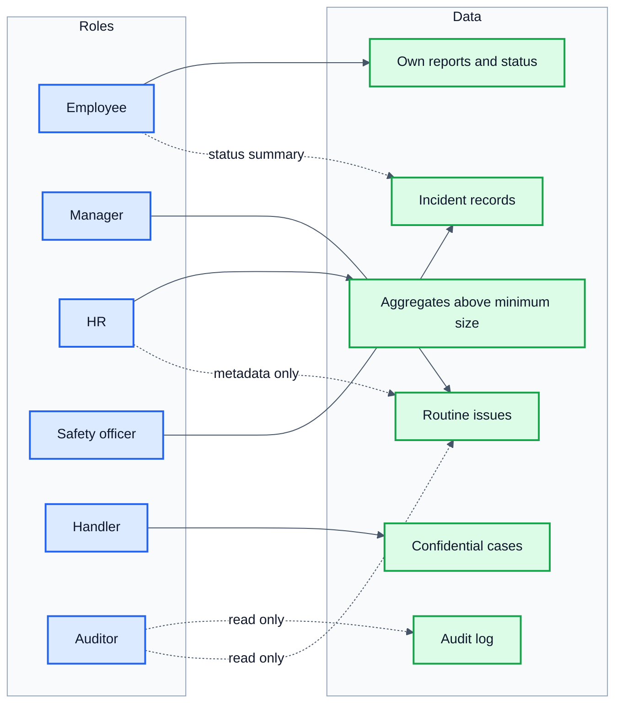

Solid arrows are full access for the stated purpose; dotted arrows are limited access. Everything not drawn is denied by default.

Enforcement rules:

- Tenant identity comes from the authenticated session or a verified provider webhook, never from a client-supplied id.
- Row-level security is on for every tenant table with a default-deny policy; the build fails if a table lacks one.
- Separate database roles for web, workers, messaging and analytics; no superuser in the application.
- The connection pool sets the tenant inside each transaction and clears it afterwards.
- Sensitive reads and exports write an access audit event.
- Operator support has no standing access; break-glass access needs approval, a time limit and customer notification.
- Negative tests try cross-tenant and cross-role access on every endpoint.

## 9. Delivery guarantees and failure handling

The platform guarantees exactly-once state transitions and idempotent notification creation. External delivery is treated as at-least-once: a provider can deliver twice when a request succeeds remotely and the response is lost. Such duplicates are reduced, detected and documented, never ignored. Every delay is made visible.

| Scenario | Guarantee | Mechanism |
|---|---|---|
| An inbound webhook arrives twice | Processed once | Inbox receipt keyed by provider and provider message id within the tenant scope, with a unique constraint |
| A state change and its event | Never one without the other | Transactional outbox; a relay publishes after commit |
| An outbox event is published twice | Harmless | Relay retries until published; consumers are idempotent |
| An outbound send is requested | One logical notification; attempts tracked separately | Notification row with an idempotency key; each attempt is a DeliveryAttempt row |
| The provider accepts but the response is lost | A duplicate delivery is possible; it is reduced and detected | Provider-side idempotency where offered; reconcile with delivery webhooks before resending; document the residual risk |
| The provider returns success | Not treated as delivery | Status becomes sent on acceptance and delivered only on a provider delivery receipt |
| A delivery webhook arrives twice or late | Status stays correct | Deduplicate callbacks; status only moves forward |
| The messaging provider is down | No loss; delay is visible | Retry with backoff, dead-letter queue after the limit, SMS fallback for safety alerts (release 2), operations alert |
| A worker crashes mid-job | The job resumes | At-least-once queue with idempotent consumers |
| A timer should fire during an outage | Not skipped | Timers stored as SLA rows; the scheduler scans for overdue rows on restart |
| Events arrive out of order | State stays correct | Version numbers; consumers ignore stale versions |
| A message cannot be delivered | The owner knows | Notification marked failed, shown to the owner and HR, alternate channel tried |
| An escalation is late | Detected | Alert on overdue SLA rows that have not escalated |

### Channels by release and purpose

| Purpose | Release | Channels | Retry budget | When it fails |
|---|---|---|---|---|
| Routine messages (pulses, issue status, confirmations) | 1 | WhatsApp only | 3 attempts over 24 hours with backoff | Notification decided `failed`; shown to the owner and in the HR delivery report; the owner follows up in the web app. No SMS. |
| Routine escalation to owners and managers | 1 | WhatsApp plus a web-app alert; optional email digest | 3 attempts over the escalation window | The next escalation level is notified; the failure is visible to HR |
| Safety alerts to responders | 2 | WhatsApp plus SMS or voice, sent in parallel | 2 attempts per channel inside the acknowledgement window | The backup responder is alerted; the officer sees "undelivered" |
| Safety status to the employee | 2 | WhatsApp, with SMS as fallback | 2 attempts per channel | Recorded; the contact-failure procedure applies |

Retry budgets and escalation rules are separate for routine and safety traffic, so a routine backlog can never delay a safety alert.

### Notification states and cancellation

A notification carries two separate things. The **status** is the sender's operational decision: it is made once, timestamped, and never changes after it is terminal. The **delivery evidence** is derived from append-only provider receipts and can be corrected when a late receipt arrives. Each delivery attempt has its own status and event history.

| Notification status | Meaning | Terminal |
|---|---|---|
| created | Row written with its idempotency key | No |
| queued | Waiting for a worker | No |
| sending | An attempt is in progress | No |
| accepted | The provider accepted a request; not yet delivered | No |
| delivered | A delivery receipt arrived for at least one attempt before the decision | Yes |
| failed | All attempts and fallback channels exhausted, or the delivery window passed with no receipt | Yes |
| cancelled | Stopped before any provider accepted it | Yes |
| expired | Passed its validity window | Yes |

Allowed moves: created → queued → sending → accepted → delivered; sending or accepted → failed; created, queued → cancelled; any non-terminal → expired. A terminal status and its `decided_at` time never change. Later facts go to the delivery evidence, not the status.

| Delivery evidence | Meaning |
|---|---|
| unknown | No receipt yet |
| confirmed | A receipt arrived before the status was decided |
| confirmed late | A receipt arrived after the status was decided (`failed`, `cancelled` or `expired`) |
| not delivered | The provider reported a final delivery failure |

Evidence rules:

- Provider receipts are stored as append-only `DeliveryAttemptEvent` rows, deduplicated by provider event id.
- Delivery-rate reports and the owner's view use the evidence, so they are corrected when late receipts arrive; audit reports show both the original decision and the later evidence.
- A late receipt never triggers a new send, never reverses a workflow or safety decision, and never reopens a closed notification. It may raise a review flag for the owner.

| Situation | Rule |
|---|---|
| Delayed receipt for an earlier attempt after a retry | Append the event to that attempt; the evidence takes the best result across attempts; the status was decided once and is not recomputed |
| Fallback channel succeeds, then the first channel also reports delivered | One logical delivery; the second success is recorded as a duplicate delivery and counted |
| Receipt arrives after the notification was cancelled, failed or expired | Appended to the attempt; the status stays as decided; the evidence becomes confirmed late; the owner can see it |
| Provider status vocabulary differs | A provider adapter maps provider statuses to these states; unknown statuses are logged and never advance the status |

**Consent withdrawal boundary.** At the moment of withdrawal:

- **Stops immediately:** created and queued notifications are cancelled; pulse schedules, connector feeds and analytics inclusion stop.
- **Cannot be recalled:** a request the provider has already accepted. The notification is marked `cancel_requested`, no retry or fallback follows, and the receipt is recorded when it arrives.
- **Continues under its own basis:** notifications with `purpose = safety` during an active incident, for its duration, as described in section 12. They are never merged with consent-based sends.
- **Audited:** the withdrawal, each cancelled notification and each later receipt.

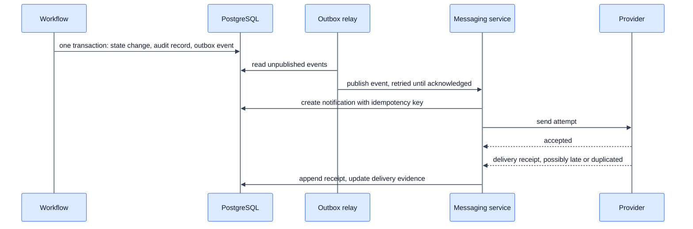

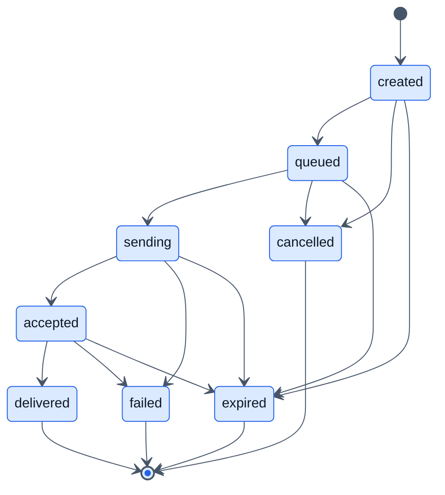

The state diagram shows the operational status only. Late receipts after a terminal state change the separate delivery evidence, never the status.

### Consistency model by operation

A reliable queue does not make the whole workflow reliable; the database, the consumer, the provider and the callback handler need compatible failure behaviour.

| Operation | Required behaviour |
|---|---|
| Receive a WhatsApp webhook | Deduplicate on provider message id within the tenant and provider scope |
| Change an issue's state | Commit the state, audit record and outbox event atomically |
| Publish an outbox event | Retry until published; duplicate publication must be harmless |
| Send a notification | One logical notification; each attempt tracked separately |
| Process a delivery webhook | Deduplicate callbacks and reconcile the notification status |
| Fire an SLA timer | Re-check the current state, deadline and escalation version before acting |
| Withdraw consent | Cancel created and queued work; mark provider-accepted sends `cancel_requested` with no retry; record late receipts; safety-purpose sends continue under their own basis |

### WhatsApp conversation engine

The channel adapter is separate from the workflow, so SMS or another channel can resume the same issue.

- Each employee has a persisted conversation with a state: idle, onboarding, awaiting a pulse answer, awaiting issue details, or awaiting confirmation.
- Free-form replies are allowed inside the provider's customer-service window; outside it, only approved templates are sent.
- Language is asked at onboarding, stored, changeable with a keyword, and falls back to the tenant default.
- Interactive buttons come with a numbered-reply fallback; an invalid reply gets one clarification, then returns to the menu.
- A conversation resumes where it stopped or times out to idle, never silently dropping a report.
- A stop keyword halts sends and records consent withdrawal.
- Per-tenant message budgets, rate limits and send windows respect shift times.

## 10. Data model

Identity and report content live in separate tables so anonymity is structural, not a display setting.

| Entity | Key fields | Notes |
|---|---|---|
| Tenant | id, name, retention_days, min_group_size | One per customer. Every other tenant-scoped table carries `tenant_id` and exposes a unique key `(tenant_id, id)` as the target of composite foreign keys. `min_group_size` may not go below the platform floor |
| Employee | id, tenant_id, phone_hash, site_id, shift_id, team_id, manager_id, language | Phone stored encrypted; hash used for lookup |
| Consent | tenant_id, employee_id, purpose, granted_at, withdrawn_at, notice_version | One row per purpose; withdrawal stops processing |
| OrganizationUnit | id, tenant_id, type, name, parent_id | Sites, shifts, teams, reporting lines and outsourced operators |
| RoutingRule | id, tenant_id, category, site_id, primary_owner_id, backup_owner_id, version | Versioned; conflict checks run before assignment |
| Pulse | id, tenant_id, questions, schedule, languages | Versioned so old answers stay interpretable |
| PulseParticipation | tenant_id, pulse_id, employee_id, answered_on | Records only that the person answered, with the date and no answers; never joined to PulseResponse; written by a separate service role; lets the employee see "answered" and stops re-prompting |
| PulseResponse | id, tenant_id, pulse_id, respondent_token, unit_id, answers | respondent_token is a keyed hash scoped to one pulse, so it cannot be joined across pulses or to the employee id; unit_id is coarsened and suppressed below the minimum size |
| Conversation | id, tenant_id, employee_id, channel, state, language, last_message_at | Persisted WhatsApp state |
| InboxReceipt | tenant_id, provider, provider_message_id, received_at, processed_at | Unique on (tenant_id, provider, provider_message_id); deduplicates webhooks |
| Issue | id, tenant_id, category, mode, text, state, version, owner_id, due_at, parent_issue_id, rule_set_version | No employee id on anonymous reports; compare-and-set on version |
| IssueContext | tenant_id, issue_id, site_id, shift_id, team_id, reported_at | Routing context only; restricted role; never exported; analytics reads a coarsened view |
| DeliveryAttempt | id, tenant_id, notification_id, channel, provider_message_id, status, attempted_at | One row per send attempt |
| DeliveryAttemptEvent | id, tenant_id, attempt_id, provider_event_id, kind, received_at | Append-only provider receipts; unique on provider and provider_event_id; feeds the derived delivery evidence |
| ReporterVault | tenant_id, issue_id, encrypted_channel_ref | Anonymous reports only; sealed table with its own key; messaging service role only |
| ConfidentialCase | tenant_id, issue_id, employee_id | Confidential reports only; restricted table; designated handler only; every read audited |
| WorkflowDefinition | id, version, from_state, to_state, guard | Platform-wide, so it carries no tenant_id; read-only to tenants; versioned allowed transitions |
| IssueEvent | id, tenant_id, issue_id, type, actor_role, at, note | Append-only; feeds the audit service |
| SlaInstance | id, tenant_id, issue_id, due_at, state, attempt_no | One row per deadline; scanned for overdue rows on restart |
| Notification | id, tenant_id, idempotency_key, purpose, status, decided_at, delivery_evidence, cancel_requested_at | One row per logical message; each send is a DeliveryAttempt row; `purpose` marks consent-based versus safety |
| OutboxEvent | id, tenant_id, aggregate_id, type, payload, published_at | Written in the same transaction as the state change |
| AuditRecord | id, tenant_id, event_ref, prev_hash, hash, at | Insert-only; checkpoints stored in external write-once storage |
| AccessAuditEvent | id, tenant_id, actor, resource, action, at | Sensitive reads, exports and administrative access |
| IncidentResponse | id, tenant_id, employee_id, state, primary_responder_id, backup_responder_id, acknowledged_at | Separate from Issue; own queue and permissions |
| ModuleConfig | tenant_id, module, enabled, settings | Drives which features each customer sees |
| Policy | id, tenant_id, region, name, version | Versioned so audits show the rule in force at the time |
| PolicyRule | policy_id, condition, action, escalate_after | Evaluated by the policy engine when an event arrives |
| Connector | id, tenant_id, type, credentials_ref, schedule, last_sync | HRIS, commute vendor, workplace tool or counselling provider |
| ExternalEvent | id, connector_id, type, employee_token, at, payload_ref | payload_ref points to encrypted storage with its own expiry |
| MetricDefinition | id, name, numerator, denominator, source, owner | Plus DataLineage for each derived dataset |
| OutcomeMetric | tenant_id, metric, group, period, value | Aggregates only |
| DataSubjectRequest | id, type, due_at, state | Plus RetentionJob rows that track deletion and verification |
| Nudge | id, manager_id, type, due_at, state | Coaching module |
| AiUsePulse | id, tenant_id, questions, schedule | Responses use respondent_token |
| AdjustmentRequest | id, employee_id, approver_id, category, state | Visible only to the employee and the named approver |

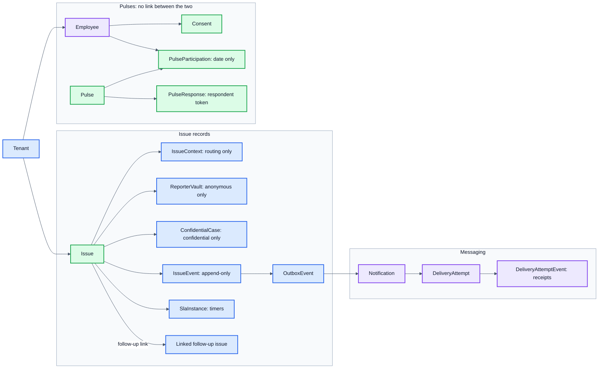

PulseResponse has no link to Employee or PulseParticipation by design; the two pulse branches never join. Every table also carries tenant_id, and the Tenant table is the only root.

### Integrity constraints

- **Tenant-consistent keys:** every tenant-scoped table lists `tenant_id`. Each parent table has a unique key `(tenant_id, id)`, and every child references it with a composite foreign key `(tenant_id, parent_id)`, so a row can never reference another tenant's row. The only tables without `tenant_id` are `Tenant` itself and the platform-wide `WorkflowDefinition`. A build check fails if a table lacks `tenant_id` and is not on that list.
- **Uniqueness:** `InboxReceipt (tenant_id, provider, provider_message_id)`; `Notification (tenant_id, idempotency_key)`; `DeliveryAttempt (provider, provider_message_id)`; one `ConfidentialCase` or `ReporterVault` row per issue, and none for the other modes (enforced by a check on `mode`).
- **State validity:** `state` changes only through a function that checks `WorkflowDefinition`; a trigger rejects any other update; `version` must increase by exactly one.
- **Links:** `parent_issue_id` must point to an issue of the same tenant, may not point to itself, and creates no cycles.
- **Deletion:** deleting a tenant, employee or issue goes through a `RetentionJob` that deletes in dependency order, honours legal holds, and leaves a deletion-ledger entry; direct deletes are blocked by role permissions.
- **Migration tests:** each constraint has a test that tries to violate it (cross-tenant reference, duplicate key, illegal transition, cycle, delete under hold) and expects a rejection.

## 11. Tech stack

Use one language end to end (TypeScript), one PostgreSQL database and managed cloud services, so a small team can build and run the whole platform. These are recommendations to confirm against your team's skills.

| Layer | Choice | Why | Alternative |
|---|---|---|---|
| Web front end | Next.js (React, TypeScript), Tailwind CSS, installable as a PWA | One codebase for desktop and phone | Vue or plain React with Vite |
| Internationalisation | i18next with translation files per language | Multilingual UI and message templates from day one | Next.js i18n routing |
| Backend | Node.js with NestJS (TypeScript), modular monolith | Same language as the front end; module boundaries map to product modules | Python with FastAPI |
| API | REST with an OpenAPI spec, plus webhooks | Easy for customers and vendors to integrate | GraphQL, only if clients need flexible queries |
| Database | PostgreSQL with row-level security per tenant | One reliable store; tenant isolation enforced in the database | Managed MySQL |
| Cache and rate limits | Redis | Sessions, rate limiting, short-lived locks | Cloud-managed cache |
| Jobs and timers | BullMQ on Redis, escalation timers persisted in PostgreSQL | Retries and scheduling built in; timers survive restarts | SQS, or Temporal for complex workflows later |
| WhatsApp | WhatsApp Business Platform via a Business Solution Provider, or Meta's Cloud API | Official channel; template approval and opt-in handled properly | Another approved provider |
| SMS and voice | An India-capable provider (for example Exotel, MSG91 or Twilio) | SOS alerts and fallback delivery; confirm India SMS registration rules before launch | Cloud-provider messaging |
| Authentication | OIDC and SAML via a managed identity service (Auth0, Keycloak or AWS Cognito); WhatsApp OTP for employees | Enterprise SSO without building it | Passport.js, which costs more to secure |
| File storage | S3-compatible object storage, server-side encryption | Evidence files and exports | Any cloud object store |
| Analytics | SQL models in a PostgreSQL reporting schema, managed with dbt | Enough for the pilot; aggregate-only outputs | ClickHouse or BigQuery at scale |
| AI features (later) | Hosted LLM API for translation, categorisation and summaries; personal data redacted first; human review | Fast to add; privacy handled before text leaves the system | Self-hosted open model |
| Cloud and hosting | One major cloud, India region (for example AWS Mumbai); ECS Fargate containers; Terraform | Data residency, low operations load, repeatable environments | Kubernetes later |
| CI/CD | GitHub Actions with dev, staging and production environments | Automated tests and deploys | GitLab CI |
| Observability | OpenTelemetry, Grafana or Datadog, Sentry, an on-call tool (Opsgenie or PagerDuty) | Alert on failed sends and stuck escalations | A single vendor suite |
| Security | KMS for keys, secrets manager, web application firewall, dependency and code scanning, yearly penetration test | Meets enterprise buyer checklists; supports ISO 27001 | Managed security service |
| Testing | Jest (unit), Playwright (end to end), load tests for message bursts | Pulses reach many employees at once | Cypress |

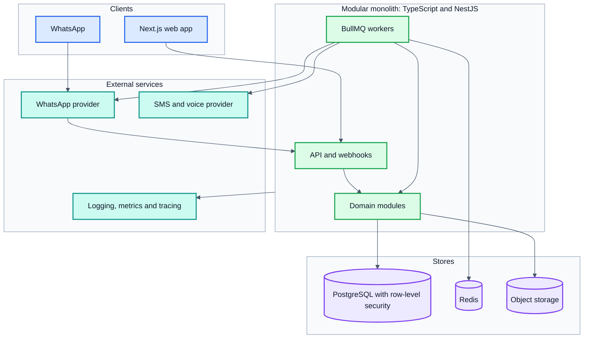

## 12. Privacy, security and data lifecycle

Trust is the product: if employees doubt anonymity, the loop never starts.

- **Honest anonymity.** Three reporting modes; anonymity is from the employer only (see [section 7](#7-reporting-modes-and-anonymity)).
- **Minimum group size.** A platform floor of 5, hard-coded and not configurable, applies to every tenant. A tenant may raise its threshold (default 8) but never lower it below the floor. The numbers are a pilot decision needing privacy review, not a universal anonymity guarantee. Suppression also covers differencing across queries (see section 7).
- **Consent per purpose.** Record notice version and timestamp; withdrawal stops processing. India's DPDP Rules were notified on 13 November 2025, so have counsel confirm which employee-data uses need consent and which fall under legitimate use.
- **Encryption and access.** Encrypt phone numbers and free text at rest, TLS in transit, role-based access, tenant isolation on every query, logged admin access.
- **Sensitive reports.** Harassment and safety complaints follow the employer's legal process and go to the designated handler or committee.
- **Certification path.** Plan ISO 27001 early; enterprise buyers in this market ask for it.

### Module-specific rules

- Commute and safety location data is collected only during an active trip or shift, only with consent, and deleted on the tenant's retention schedule.
- Wellbeing referrals never share conversation content with the employer; HR sees aggregate trends only.
- SOS and incident records are linked to the employee by design. The full case is visible only to the safety officer, responders on the case and the audit log; the employee sees a status summary.
- Adjustment requests are visible only to the employee and the named approver.
- AI-use pulses are anonymous, use the same minimum group size, and follow the same pulse model: participation is visible to the employee, answers are not.
- Policies are versioned, so an audit shows the rules in force when an incident happened.

### Data lifecycle and audit integrity

| Topic | Rule |
|---|---|
| Lawful basis | Keep a register with counsel: for each processing activity, the purpose, data, lawful basis, access rule and retention period. Optional activities (pulses, wellbeing, AI-use pulse) rely on consent. Safety processing may rely on a different basis if counsel confirms it. |
| Withdrawal during an active incident | Optional consents stop. An active safety response continues for its duration under its own basis, the employee is told so when enabling safety features, and the record follows the incident retention rule. |
| Consent withdrawal | An event stops pulse sends, cancels queued messages, disables the person's connector feeds, excludes them from future aggregates and writes an audit record. Sends already accepted by the provider cannot be recalled; they are marked `cancel_requested`, get no retry or fallback, and their receipts are recorded. Nothing new starts. Existing aggregates above the minimum group size may remain if counsel confirms they are not identifying. |
| Retention jobs | A daily job per tenant and data class deletes expired data; a second job verifies the deletion; failures raise an alert. |
| Free text | Deleted at the tenant's retention limit; only aggregate counts are kept. |
| Backups | Encrypted; deleted data ages out within the backup retention period; a restore re-applies the deletion ledger. |
| Legal hold | A flag on a case freezes its deletion; only named roles can set or release it; both are audited. |
| Audit records and deletion | Audit records are never edited. A correction is a new record that references the old one. When retention requires deleting personal content, the audit row keeps its hash chain, event type, actor role and timestamps, and the personal fields are replaced by a redaction marker recorded in the chain. A legal hold also freezes the audit rows it covers. |
| Confidential handler access | Designated handlers read the identity mapping through the restricted `ConfidentialCase` table only. Managers, HR (unless designated) and admins have no read path, direct or through joins, views or exports. A test covers every role. |
| Pulse tokens | `respondent_token` is a keyed hash scoped to one pulse. The key is held outside the analytics schema, the token appears in no table with an employee id, and no export carries both. |
| Pulse model | Pulses are anonymous: nobody, including the employee, can retrieve an individual answer afterwards. The employee sees only whether they answered, from `PulseParticipation` (date only, no answers). That table is never joined to responses and is written by a separate service role. If a customer wants retrievable personal answers, that is a different, identified feature with its own consent, table and tests, and it is not part of release 1. |
| Data-subject requests | Tracked with due dates and an owner, following a procedure approved by counsel. |
| Derived data | Each derived dataset has lineage; deleting a source triggers a rebuild of dependent aggregates. |
| Data classes | Anonymous feedback, confidential complaints and identifiable safety records are stored and retained separately. |

**Audit integrity:** a hash chain only shows tampering if the attacker cannot recompute it. So the application role has insert-only rights on audit tables, a periodic checkpoint hash is written to write-once storage in a separate account (and can be shared with the customer), a verification job compares the chain to the checkpoints, and backups are protected from the application's credentials.

```mermaid
%%{init: {'theme':'base','themeVariables':{'fontSize':'15px','primaryColor':'#dbeafe','primaryTextColor':'#0f172a','primaryBorderColor':'#2563eb','secondaryColor':'#dcfce7','secondaryTextColor':'#0f172a','secondaryBorderColor':'#16a34a','tertiaryColor':'#f1f5f9','tertiaryTextColor':'#0f172a','tertiaryBorderColor':'#94a3b8','lineColor':'#475569','textColor':'#0f172a','background':'#ffffff','edgeLabelBackground':'#ffffff','noteBkgColor':'#e0f2fe','noteTextColor':'#0f172a','noteBorderColor':'#0284c7','actorBkg':'#dbeafe','actorBorder':'#2563eb','actorTextColor':'#0f172a','actorLineColor':'#64748b','signalColor':'#334155','signalTextColor':'#0f172a','labelBoxBkgColor':'#ede9fe','labelBoxBorderColor':'#7c3aed','labelTextColor':'#0f172a','loopTextColor':'#0f172a','activationBkgColor':'#ccfbf1','activationBorderColor':'#0d9488','sequenceNumberColor':'#ffffff','stateBkg':'#dbeafe','stateLabelColor':'#0f172a','altBackground':'#f1f5f9','compositeBackground':'#f8fafc','compositeTitleBackground':'#ede9fe','innerEndBackground':'#475569','specialStateColor':'#475569','transitionColor':'#475569','transitionLabelColor':'#0f172a','attributeBackgroundColorOdd':'#f0f9ff','attributeBackgroundColorEven':'#e0f2fe'}}}%%
flowchart LR
    A["Collect with notice and purpose"] --> B["Store by data class"]
    B --> C["Use under access rules"]
    C --> D{"Retention reached or withdrawal?"}
    D -->|No| C
    D -->|Yes| H{"Legal hold?"}
    H -->|Yes| K["Keep until hold released"]
    K --> D
    H -->|No| E["Delete in dependency order"]
    E --> F["Verify deletion"]
    F --> G["Rebuild derived aggregates and re-apply ledger after restore"]
    classDef blue fill:#dbeafe,stroke:#2563eb,stroke-width:2px,color:#0f172a
    classDef green fill:#dcfce7,stroke:#16a34a,stroke-width:2px,color:#0f172a
    classDef purple fill:#ede9fe,stroke:#7c3aed,stroke-width:2px,color:#0f172a
    classDef teal fill:#ccfbf1,stroke:#0d9488,stroke-width:2px,color:#0f172a
    classDef sky fill:#e0f2fe,stroke:#0284c7,stroke-width:2px,color:#0f172a
    classDef rose fill:#fce7f3,stroke:#db2777,stroke-width:2px,color:#0f172a
    class A,F blue
    class B,G green
    class C purple
    class K teal
    class E sky
    class D,H rose
```

> This section is engineering guidance, not legal advice. Have counsel review it, including state-level night-shift rules.

## 13. Intelligence and measurement

### What rules and AI may do

- **Release 1: rules only.** Category keywords by language, urgency keywords and explicit menu choices. A person can always override the result.
- **Later: AI assists.** Duplicate clustering and summaries that link back to the source reports, shown with confidence and corrected by humans. Corrections are logged.
- **Never automatic.** Assignments, disciplinary escalations or any action about a person are decided by an authorised human.
- **Sensitive categories bypass AI** and go straight to the restricted queue.
- **Controls.** Test for bias across languages, redact personal data before text leaves the system, and have a contract covering any external model provider. The contract must forbid retaining report text or using it for training, and the sensitive-category bypass is a deterministic rule that runs before any model call, with a test proving no model call happens for those reports.

### How outcomes are measured

```mermaid
%%{init: {'theme':'base','themeVariables':{'fontSize':'15px','primaryColor':'#dbeafe','primaryTextColor':'#0f172a','primaryBorderColor':'#2563eb','secondaryColor':'#dcfce7','secondaryTextColor':'#0f172a','secondaryBorderColor':'#16a34a','tertiaryColor':'#f1f5f9','tertiaryTextColor':'#0f172a','tertiaryBorderColor':'#94a3b8','lineColor':'#475569','textColor':'#0f172a','background':'#ffffff','edgeLabelBackground':'#ffffff','noteBkgColor':'#e0f2fe','noteTextColor':'#0f172a','noteBorderColor':'#0284c7','actorBkg':'#dbeafe','actorBorder':'#2563eb','actorTextColor':'#0f172a','actorLineColor':'#64748b','signalColor':'#334155','signalTextColor':'#0f172a','labelBoxBkgColor':'#ede9fe','labelBoxBorderColor':'#7c3aed','labelTextColor':'#0f172a','loopTextColor':'#0f172a','activationBkgColor':'#ccfbf1','activationBorderColor':'#0d9488','sequenceNumberColor':'#ffffff','stateBkg':'#dbeafe','stateLabelColor':'#0f172a','altBackground':'#f1f5f9','compositeBackground':'#f8fafc','compositeTitleBackground':'#ede9fe','innerEndBackground':'#475569','specialStateColor':'#475569','transitionColor':'#475569','transitionLabelColor':'#0f172a','attributeBackgroundColorOdd':'#f0f9ff','attributeBackgroundColorEven':'#e0f2fe'}}}%%
flowchart LR
    BL["Baseline period"] --> ACT["Actions taken: owner and deadline"]
    ACT --> OUT["Outcomes: time to resolve, recurrence, confirmation rate"]
    OUT --> AGG["Aggregates above minimum group size"]
    AGG --> DASH["Dashboards: compared with baseline"]
    DASH --> REV["Human review: no causal claims"]
    REV --> ACT
    classDef blue fill:#dbeafe,stroke:#2563eb,stroke-width:2px,color:#0f172a
    classDef green fill:#dcfce7,stroke:#16a34a,stroke-width:2px,color:#0f172a
    classDef purple fill:#ede9fe,stroke:#7c3aed,stroke-width:2px,color:#0f172a
    classDef teal fill:#ccfbf1,stroke:#0d9488,stroke-width:2px,color:#0f172a
    classDef sky fill:#e0f2fe,stroke:#0284c7,stroke-width:2px,color:#0f172a
    classDef rose fill:#fce7f3,stroke:#db2777,stroke-width:2px,color:#0f172a
    class BL,REV blue
    class ACT green
    class OUT purple
    class AGG teal
    class DASH sky
```

- **Metric registry.** Each metric has a definition, numerator, denominator, source and owner.
- **Baselines.** Collect a baseline period before the pilot and fix the observation window in advance.
- **Data quality.** Missing or late vendor data is marked missing, not guessed.
- **Privacy.** Joins run on tokens in a protected schema; outputs are aggregate-only, with suppression below the minimum group size.
- **Causality.** Report changes as associations. Claim impact only where a comparison design supports it. Falling attrition after launch is not proof the platform caused it.

## 14. Roadmap and release plan

```mermaid
%%{init: {'theme':'base','themeVariables':{'fontSize':'15px','primaryColor':'#dbeafe','primaryTextColor':'#0f172a','primaryBorderColor':'#2563eb','secondaryColor':'#dcfce7','secondaryTextColor':'#0f172a','secondaryBorderColor':'#16a34a','tertiaryColor':'#f1f5f9','tertiaryTextColor':'#0f172a','tertiaryBorderColor':'#94a3b8','lineColor':'#475569','textColor':'#0f172a','background':'#ffffff','edgeLabelBackground':'#ffffff','noteBkgColor':'#e0f2fe','noteTextColor':'#0f172a','noteBorderColor':'#0284c7','actorBkg':'#dbeafe','actorBorder':'#2563eb','actorTextColor':'#0f172a','actorLineColor':'#64748b','signalColor':'#334155','signalTextColor':'#0f172a','labelBoxBkgColor':'#ede9fe','labelBoxBorderColor':'#7c3aed','labelTextColor':'#0f172a','loopTextColor':'#0f172a','activationBkgColor':'#ccfbf1','activationBorderColor':'#0d9488','sequenceNumberColor':'#ffffff','stateBkg':'#dbeafe','stateLabelColor':'#0f172a','altBackground':'#f1f5f9','compositeBackground':'#f8fafc','compositeTitleBackground':'#ede9fe','innerEndBackground':'#475569','specialStateColor':'#475569','transitionColor':'#475569','transitionLabelColor':'#0f172a','attributeBackgroundColorOdd':'#f0f9ff','attributeBackgroundColorEven':'#e0f2fe'}}}%%
flowchart TB
    P1[Phase 1: Validate<br/>interview 10 to 15 HR and operations leaders;<br/>set anonymity and escalation rules, WhatsApp templates] --> G1{{Gate: 2 to 3 design partners committed}}
    G1 --> P2[Phase 2: Build and harden the MVP<br/>roster upload, pulse, issue workflow, manager and HR views,<br/>audit log, trust and reliability tests]
    P2 --> G2{{Gate: isolation, anonymity, delivery and restore tests pass}}
    G2 --> P3[Phase 3: Pilot, 8 to 12 weeks<br/>response rate, issues closed on time,<br/>manager action rate]
    P3 --> G3{{Gate: agreed metrics met and customers will pay}}
    G3 --> P4[Phase 4: Harden and integrate<br/>HRIS connectors, SSO, ISO 27001 path,<br/>multi-site rollout]
    P4 --> G4{{Gate: first paid contracts renewed or expanded}}
    G4 --> P5[Phase 5: Expand<br/>policy engine, connectors, analytics,<br/>then the seven modules one at a time]
    classDef blue fill:#dbeafe,stroke:#2563eb,stroke-width:2px,color:#0f172a
    classDef green fill:#dcfce7,stroke:#16a34a,stroke-width:2px,color:#0f172a
    classDef purple fill:#ede9fe,stroke:#7c3aed,stroke-width:2px,color:#0f172a
    classDef teal fill:#ccfbf1,stroke:#0d9488,stroke-width:2px,color:#0f172a
    classDef sky fill:#e0f2fe,stroke:#0284c7,stroke-width:2px,color:#0f172a
    classDef rose fill:#fce7f3,stroke:#db2777,stroke-width:2px,color:#0f172a
    class P1 blue
    class P2 green
    class P3 purple
    class P4 teal
    class P5 sky
    class G1,G2,G3,G4 rose
```

| Release | What ships | Gaps closed | Depends on |
|---|---|---|---|
| 1 | Core loop and a thin module framework | 2, 5, 6, 7, 8, 9 (CSV), 11 (top three) | Nothing |
| 2 | Policy engine, connector layer, outcome analytics, Safety module | 1, 3, 4, 9 | Pilot data from release 1; one HRIS and one commute vendor agreed |
| 3 | Commute, Workplace, Wellbeing, AI trust, Manager coaching and Inclusion modules | 1, 3, 10, 11, 12 | Connector layer and outcome analytics |

The trust and reliability tests in phase 2 must pass **before any real employee data is used**. Only the pilot length is fixed here; set the other durations after validation. Any module can be pulled forward if a design partner needs it; the architecture does not change.

## 15. Success metrics and acceptance tests

### Success metrics

Set numeric targets from pilot baselines and agree thresholds with design partners.

| Dimension | Metrics |
|---|---|
| Responsiveness | Time to acknowledgement; time to first meaningful action; time to resolution |
| Reliability | Message delivery success; duplicate-processing rate; failed or delayed escalation rate |
| Resolution quality | Reopen rate; repeat-issue rate; employee-confirmed resolution versus unconfirmed closure |
| Employee trust | Consent withdrawal rate; perceived anonymity; confidence in follow-through |
| Privacy and security | Unauthorised access incidents; retention-job failures; open cross-tenant test failures |
| Adoption | Week-4 retention; pulse completion by shift and language; reporting completion |
| Business value | Admin effort per issue; recurring operating cost; willingness to pay; renewal or expansion |

Before building, test willingness to pay: would HR and operations leaders at shift-based employers pay for this instead of a WhatsApp group plus a spreadsheet? If not, the MVP needs a stronger hook.

```mermaid
%%{init: {'theme':'base','themeVariables':{'fontSize':'15px','primaryColor':'#dbeafe','primaryTextColor':'#0f172a','primaryBorderColor':'#2563eb','secondaryColor':'#dcfce7','secondaryTextColor':'#0f172a','secondaryBorderColor':'#16a34a','tertiaryColor':'#f1f5f9','tertiaryTextColor':'#0f172a','tertiaryBorderColor':'#94a3b8','lineColor':'#475569','textColor':'#0f172a','background':'#ffffff','edgeLabelBackground':'#ffffff','noteBkgColor':'#e0f2fe','noteTextColor':'#0f172a','noteBorderColor':'#0284c7','actorBkg':'#dbeafe','actorBorder':'#2563eb','actorTextColor':'#0f172a','actorLineColor':'#64748b','signalColor':'#334155','signalTextColor':'#0f172a','labelBoxBkgColor':'#ede9fe','labelBoxBorderColor':'#7c3aed','labelTextColor':'#0f172a','loopTextColor':'#0f172a','activationBkgColor':'#ccfbf1','activationBorderColor':'#0d9488','sequenceNumberColor':'#ffffff','stateBkg':'#dbeafe','stateLabelColor':'#0f172a','altBackground':'#f1f5f9','compositeBackground':'#f8fafc','compositeTitleBackground':'#ede9fe','innerEndBackground':'#475569','specialStateColor':'#475569','transitionColor':'#475569','transitionLabelColor':'#0f172a','attributeBackgroundColorOdd':'#f0f9ff','attributeBackgroundColorEven':'#e0f2fe'}}}%%
flowchart LR
    SPEC["Specification"] --> SCH["Schema and migration tests"]
    SCH --> CORE["Core workflow with simulated provider"]
    CORE --> AT["Acceptance tests pass"]
    AT --> PRIV["Privacy and security gates"]
    PRIV --> PIL["Pilot with real employee data"]
    PIL --> SG{"Staffed rota and drills passed?"}
    SG -->|Yes| SAFE["Enable Safety module"]
    SG -->|No| HOLD["Keep Safety off"]
    classDef blue fill:#dbeafe,stroke:#2563eb,stroke-width:2px,color:#0f172a
    classDef green fill:#dcfce7,stroke:#16a34a,stroke-width:2px,color:#0f172a
    classDef purple fill:#ede9fe,stroke:#7c3aed,stroke-width:2px,color:#0f172a
    classDef teal fill:#ccfbf1,stroke:#0d9488,stroke-width:2px,color:#0f172a
    classDef sky fill:#e0f2fe,stroke:#0284c7,stroke-width:2px,color:#0f172a
    classDef rose fill:#fce7f3,stroke:#db2777,stroke-width:2px,color:#0f172a
    class SPEC,PIL blue
    class SCH,SAFE green
    class CORE,HOLD purple
    class AT teal
    class PRIV sky
    class SG rose
```

### Acceptance tests

Each critical behaviour needs a passing test before real employee data is used.

| Area | Test | Pass criteria |
|---|---|---|
| Tenant isolation | A user of tenant A calls every endpoint with tenant B's ids | No data returned; the build fails if any tenant table lacks a policy |
| Anonymity | Search every table, log, trace and export reachable by manager and HR roles for reporter identifiers; run the timing and small-group review | No identifier found; review signed off |
| Identity paths | For each reporting mode, follow identity through logs, provider callbacks, support tools, exports and backups | Only the documented resolvers can link a report to a person |
| Duplicate inbound | Replay each webhook ten times | One state change and one reply |
| Duplicate outbound | Simulate a provider that accepts a request but loses the response | The duplicate is detected from delivery receipts and recorded; state stays correct |
| Escalation | Stop workers for longer than the deadline, then restart | Every overdue issue escalates exactly once |
| Concurrency | Two actors reassign and resolve the same issue at once | One succeeds, the other gets a conflict, and the state is valid |
| Late reply | Send "not fixed" inside and after the grace period | Reopen inside; linked follow-up after; original audit history unchanged |
| Incident response | The primary responder never acknowledges | Backup alerted within the window; employee status stays accurate; an undelivered alert uses the alternate channel |
| Unresolved incident | The employee cannot be reached, or the situation stays unsafe | Contact-failure procedure runs, the incident escalates with a recorded handoff, and the status shown is truthful |
| Consent withdrawal | Withdraw consent, then trigger a pulse; also withdraw while a send is provider-accepted | No new send; queued messages cancelled; accepted send marked `cancel_requested` with no retry; late receipt recorded; audit present |
| Contextual re-identification | Combine site, shift, team and date filters on every dashboard and export, including repeated narrowing queries | No result below the minimum group size; reporter not identifiable from any combination |
| Notification terminal states | Deliver a late receipt after a retry, after a fallback success, after failure and after cancellation | Decided status and time unchanged; evidence corrected to confirmed late; duplicates recorded; no resend and no workflow change |
| Pulse unlinkability | Try every role and service to link a participation row to a response, by id, timestamp or token | No path exists; HR, managers and analytics cannot identify any answer |
| Suppression differencing | Run overlapping periods and groups, and remove one member between two queries | No released figure reveals a group below the floor; complementary suppression applies |
| Tenant keys | Insert a child row that references a parent from another tenant | Rejected by the composite foreign key |
| Channel scope | Fail WhatsApp for a routine message in release 1 | No SMS is sent; the failure shows to the owner and HR; safety traffic is unaffected |
| Rota drill | Run the incident drill with the real rota | Windows met, handoff recorded, contact-failure procedure followed |
| Constraint violations | Try cross-tenant references, duplicate keys, illegal transitions, cycles and deletes under hold | Every attempt rejected |
| Role leakage | Every role tries to read confidential mappings, pulse tokens and routing context | Only documented roles succeed |
| Retention | Let data expire | Deletion verified; backups follow policy |
| Audit integrity | Alter an audit row directly | The verification job detects it |
| Load | Send a pulse to every employee of the largest tenant | Queue drains within the agreed window; no duplicates |
| Restore | Restore a backup into a clean environment | Service works and the deletion ledger is re-applied |

## 16. Proposed repository structure

```text
.
├── apps/
│   ├── web/                 # Next.js app: manager, HR, admin screens
│   └── api/                 # NestJS backend (modular monolith)
├── packages/
│   ├── core/                # pulse, issue and incident workflows, routing, identity, audit, insights
│   ├── platform/            # module framework, policy engine, connectors, analytics, outbox
│   ├── modules/
│   │   ├── safety/
│   │   ├── commute/
│   │   ├── wellbeing/
│   │   ├── workplace/
│   │   ├── ai-trust/
│   │   ├── coaching/
│   │   └── inclusion/
│   ├── messaging/           # WhatsApp, SMS, email adapters and conversation engine
│   └── shared/              # types, i18n, utilities
├── infra/                   # Terraform, environment config
├── docs/                    # core-workflow-and-trust-spec.md, runbooks, API docs
└── README.md
```

## 17. Getting started (when code exists)

There is nothing to run yet. When the first code lands, this section should cover:

```bash
# prerequisites: Node.js LTS, PostgreSQL, Redis, a WhatsApp sandbox number
git clone <repo-url>
cd <repo>
cp .env.example .env      # database, Redis, WhatsApp provider keys
npm install
npm run db:migrate
npm run dev
```

Keep secrets out of the repository, use a provider sandbox for WhatsApp in development, and seed test tenants with fake rosters only.

## 18. Assumptions and open questions

This design is a proposal built on assumptions, not validated facts. Items 1 to 5 also need input from counsel or customers (see the specification).

- [ ] Which customer first: IT or GCC, BPO, or manufacturing? This sets the utility hook and the default categories.
- [ ] Is India the only market for the MVP? This affects data residency and WhatsApp template approvals.
- [ ] Will customers accept WhatsApp as the primary channel, or do some require their own apps for security reasons?
- [ ] Who inside the customer owns the budget: HR, operations or IT?
- [ ] Legal basis for each processing purpose, and which uses need consent under India's DPDP rules.
- [ ] How confidential reports interact with workplace-harassment committee requirements and mandatory disclosure.
- [ ] Who the designated handler is at each customer, the backup rota and the acknowledgement windows.
- [ ] Retention period for each data class, and whether anonymous mode is allowed for sensitive categories.
- [ ] Which HRIS systems must be integrated first, if the roster upload proves too manual?
- [ ] What default timers will pilots show to be realistic?
- [ ] Which pricing model fits: per employee per month, per site, or per resolved issue?
- [ ] Which module should follow the core loop first: Safety, Commute or outcome analytics?
- [ ] Have the market statistics and the Karnataka claims been checked against primary sources (the Act and gazette text, original reports)? Do not use them in a pitch or a compliance claim until they have.
- [ ] Who staffs the responder rota at each pilot, and for which hours?

## 19. Evidence and sources

Do not use these statistics or the Karnataka legal claims in sales decks or compliance assurances until each has been checked against the original report, the Act or the gazette text. Figures were gathered from public web sources in October 2026. Several come from vendor-run surveys or secondary coverage, and some India data is dated, so treat them as directional. Full reports were not read in every case.

- [Gallup, State of the Global Workplace 2026](https://www.gallup.com/workplace/349484/burnout-work.aspx)
- [Gallup 2025, India findings (Gulf News)](https://gulfnews.com/world/asia/india/half-of-indian-employees-want-to-quit-jobs-30-face-daily-stress-gallup-report-reveals-1.500114812)
- [Great Place To Work India, burnout study](https://english.madhyamam.com/lifestyle/health/25-of-employees-hesitant-to-discuss-stress-and-burnout-at-work-report-1269710)
- [WEF Future of Jobs 2025, workforce strategies](https://cn.weforum.org/publications/the-future-of-jobs-report-2025/in-full/4-workforce-strategies)
- [Deloitte 2026 Human Capital Trends](https://www.deloitte.com/dk/en/events/Human-Capital-Trends-2026.html)
- [Workday AI trust survey](https://www.workday.com/en-us/perspectives/ai/ai-at-work-september.html)
- [Dexian Work Futures 2026 (HR Dive)](https://www.hrdive.com/news/workforce-AI-trust-upskilling-CIO/811447/)
- [Remote, hybrid and onsite wellbeing study (HCAmag)](https://www.hcamag.com/us/specialization/corporate-wellness/hybrid-work-sounded-like-the-happiest-medium-it-isnt/586922)
- [King's Business School on return-to-office](https://www.kcl.ac.uk/news/return-to-office-rules-risk-creating-worst-of-both-worlds-for-hybrid-workers)
- [Karnataka 2026 amendment, key changes (Khaitan)](https://ksandk.com/newsletter/karnataka-shops-and-commercial-establishments-amendment-act-2026-key-changes-for-employers/)
- [KITU rollback demand (The News Minute)](https://www.thenewsminute.com/karnataka/karnataka-it-union-demands-rollback-of-law-removing-womens-night-shift-safeguards)
- [DPDP Act and GPS tracking (Mondaq)](https://www.mondaq.com/india/privacy-protection/1744892/dpdp-act-compliance-for-logistics-and-supply-chain-companies-in-india-gps-tracking-telematics-and-workforce-data-risks)
- [Routematic GCC commute maturity report (TimesTech)](https://timestech.in/routematic-60-of-gccs-still-lack-integrated-commute-systems-amid-rising-esg-needs/)
- [Routematic Series C](https://channeldrive.in/investment/routematic-secures-40-million-series-c-funding/)
- [Uber and the GCC boom (Inc42)](https://inc42.com/features/amid-indias-gcc-boom-uber-takes-the-corporate-transport-lane/)
- [Eptura overview (Robin)](https://robinpowered.com/blog/eptura-overview)
- [Gartner Market Guide for Workplace Experience Applications (ServiceNow)](https://www.servicenow.com/lpayr/gartner-market-guide-workplace-experience-apps.html)
- [Employee listening platform comparison](https://thehappinessindex.com/?p=3781)
- [Benifex on fragmented employee tech](https://benifex.com/resources/blog/in-a-digital-first-world-of-work-why-is-hr-tech-playing-second-fiddle)

## 20. Contributing and license

Contribution guidelines and a license have not been chosen yet. Before opening the repository to others, decide on a license, add a `CONTRIBUTING.md`, and write a short security policy for reporting vulnerabilities.
